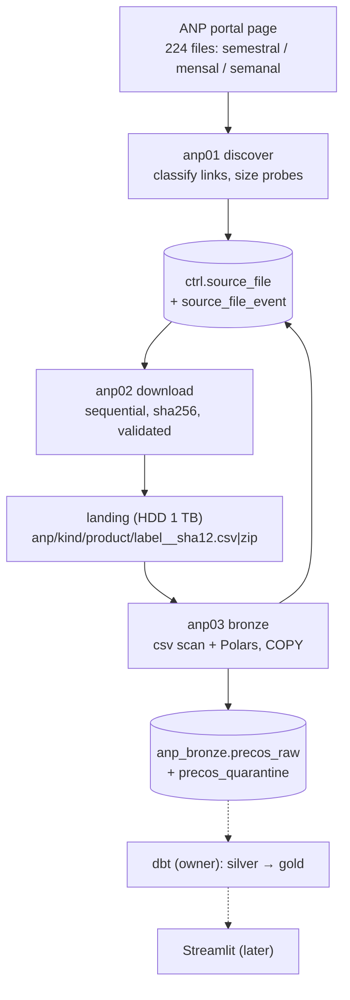

# lambda4 — ANP fuel prices architecture (up to bronze)

Reference for the ANP pipeline (fuel price survey, full history since 2004): what runs, where data lives, which script
writes which table, how it is observed. Decisions: ADR 0006. Study material in Portuguese: `docs/learning/08`.
Silver, gold and the Streamlit app are built by the owner on top of `anp_bronze.precos_raw` (dbt, section 5).

## 1. End-to-end flow



## 2. The DAG `anp_pipeline` (`airflow/dags/dag_anp.py`)

`preflight → discover → download → bronze → finalize`, daily 08:00 America/Sao_Paulo, **created paused**.

| Task | Exit 99 (skipped) when | Notes |
|---|---|---|
| preflight | — | BLOCK: Postgres + ANP tables, landing mounted. WARN: disks, portal, observability |
| discover | nothing to download and nothing waiting for bronze | downstream is skipped too |
| download | nothing pending | retries 2; failed files stay FAILED and are retried next run |
| bronze | nothing pending | `trigger_rule=none_failed`: also runs when download had nothing new; outlet asset `anp_bronze.precos_raw` |
| finalize | — | `all_done`, closes `audit.pipeline_run`, fails if the run failed |

Params: `full_recheck` (probe every downloaded file), `kinds` and `limit` (a small manual run, e.g. `semanal`, 3).

## 3. Lineage

| Script | Reads | Writes |
|---|---|---|
| `anp00_preflight` | Postgres catalog, disks, portal | `audit.health_check` |
| `anp01_discover` | portal page, ranged GETs, `ctrl.source_file` | `ctrl.source_file` (new / changed / unlisted), events DISCOVERED, CHANGED_AT_SOURCE, UNLISTED, RELISTED |
| `anp02_download` | `ctrl.source_file` (pending) | landing files; ctrl DOWNLOADED / FAILED / MISSING_AT_SOURCE / duplicate; events |
| `anp03_bronze` | landing files (ZIPs extracted to `/srv/scratch/anp-extract`, deleted after) | `anp_bronze.precos_raw`, `precos_quarantine`, ctrl LOADED + event, all in ONE transaction per file; `audit.quarantine_summary` |

## 4. Data model

**`ctrl.source_file`** (one row per `(pipeline, file_key)`): source kind, product group, period, URL, link text;
discovery (`listed`, first/last seen, `remote_bytes`); download (`download_status`, `version`, `local_path`,
`sha256`, `file_format`, `duplicate_of`); bronze (`bronze_status`, `bronze_sha256`, `bronze_rows`,
`bronze_quarantined`, `loaded_at`). **`ctrl.source_file_event`**: append-only history of every change.

**`anp_bronze.precos_raw`** — partitions `precos_raw_semestral | _mensal | _semanal`:

| Column | Content |
|---|---|
| `regiao_sigla` … `bandeira` (16) | text exactly as published (e.g. `" 49.051.667/0001-02"`, `"2,899"`, `"02/01/2014"`); empty → NULL |
| `_source_kind`, `_file_key` | which file (→ `ctrl.source_file`) |
| `_file_sha256` | which content version |
| `_record_no` | record number inside the file (header excluded) |
| `_run_id`, `_ingested_at` | which run loaded it (→ `audit.pipeline_run`) |

Overlap: since 2023 the same collection can be in a semester, a month and a weekly file. Bronze keeps all of them.

**`anp_bronze.batch_profile`** — statistics per **survey batch** (*lote de pesquisa* = one file × one collection
month, `batch_month` = YYYYMM of `data_da_coleta`, 0 = unparseable date) and product (`produto = '*'` = the whole
batch): `rows`, `stations` (distinct CNPJ digits), `brands`, `cities`, `ufs`, `price_avg/min/p50/max/stddev`,
`price_missing`, `buy_price_avg`. Written by anp03 from the rows it just loaded, in the same transaction (replaced on
reload); `python -m pipelines.anp.anp03_bronze --reprofile` recomputes it for loaded files. Prices and dates are
parsed only here (profiling); bronze stays raw. **`anp_bronze.v_batch_matrix`**: one row per batch with the average
price of each product in columns (gasolina … glp), stations, brands, `other_product_rows`, `price_missing`.

## 5. For the dbt project (owner)

* Source: `anp_bronze.precos_raw` (`loaded_at_field: _ingested_at`); control/lineage in `ctrl.source_file` (join on
  `_file_key` for period and kind). Quarantine: `anp_bronze.precos_quarantine`.
* Suggested design (accepted in planning, 2026-10-22): silver `anp_preco_coleta` at the grain `cnpj + produto +
  data_coleta`, dedup by source priority **semestral > mensal > semanal** then latest `_ingested_at`; dbt snapshot
  of the station (SCD2 of brand, address, name); gold `dim_posto` (natural key CNPJ), `dim_endereco` (md5 of the
  normalised address), `dim_produto` (natural key), `dim_bandeira`, `dim_municipio` (UF + name, IBGE seed later),
  `dim_data`, fact `fato_preco_coleta` and a weekly aggregate UF × product for the Streamlit app.
* Typing facts from the data: decimal comma (`2,899`), dates `dd/mm/yyyy`, CNPJ with mask and a leading space, GLP
  priced per 13 kg bottle (`R$ / 13 kg`), `valor_de_compra` mostly NULL.
* dbt runs from `~/.envs/env-dbt` (dbt-core 1.12, dbt-postgres 1.11); Cosmos 1.15 is installed in Airflow. Schedule
  the dbt DAG on the asset `anp_bronze.precos_raw`.

## 6. Observability

**Grafana dashboard `lambda4-anp` — "ANP · Pipeline health & survey batches"** (folder *Lambda4*, built by
`infra/grafana/build_dashboards.py`, variables: run, file kind, product):

* **Section 1 · Pipeline health:** run status/duration/failed tasks/files and bytes downloaded/rows loaded/DQ
  fails/quarantine; tasks of the run, task durations, checks, preflight probes, the run's trace (audit SQL); source
  files from `ctrl` (known/downloaded/loaded/pending/failed, by kind and state, files needing attention, control
  events per day and the latest ones); Airflow `anp_pipeline` runs and task instances, Airflow task logs (Loki
  `job=airflow-tasks`), pipeline events by level and warnings/errors (`audit.log_event`).
* **Section 2 · Survey batches:** the batch matrix (`v_batch_matrix`: average price per product in columns,
  stations = distinct CNPJ, brands); months covered; monthly average price per product (fuels and GLP separately,
  one source per month: semestral > mensal > semanal); stations, brands, rows, cities/UFs per batch and file family;
  price dispersion per batch and product (min/p50/avg/max, stddev, cv %); data quality per file (quarantine, rows
  without a date or price, products outside the matrix). Survey panels show the whole history (25 y) whatever the
  dashboard time range.

Load cost (measured 2026-10-23 on a 915 k-row semester, rolled back): read 1.8 s; COPY ~45 k rows/s (psycopg3; the
same CSV with `psql \copy` or psycopg2 ~100 k rows/s, so the gap is driver overhead, not the indexes; UNLOGGED would
be ~285 k rows/s, the price of the WAL); batch profile ~12 s. First full load ≈ 15 min COPY + 8 min profile + reads.

Same contract as RFB (ADR 0004): `audit.task_run` / `pipeline_run` / `dq_event` / `log_event` / `health_check` /
`quarantine_summary`, Pushgateway metrics `job=lambda_pipeline, pipeline=anp`, Loki `job=lambda-pipelines`, one trace
per run in Tempo (`service.name=lambda-anp`). Useful events: `catalog_parsed`, `discover_done`, `file_downloaded`
(MiB/s, sha256), `file_loaded` (rows, rows/s, rows by product, stations, date range), `bronze_table_stats`.

```sql
-- what is pending / failed
SELECT download_status, bronze_status, count(*) FROM ctrl.source_file WHERE pipeline = 'anp' GROUP BY 1, 2;
-- history of one file
SELECT created_at, event, version, bytes, rows, detail FROM ctrl.source_file_event
WHERE file_key = 'semestral/ca/2014-S1' ORDER BY id;
```

## 7. Runbook

* **Once:** `psql -d lambda -v ON_ERROR_STOP=1 -f infra/postgres/anp_schema.sql` (idempotent).
* **Small first run, by hand:** `cd ~/lambda4 && export LAMBDA_RUN_ID=manual__$(date -u +%Y%m%dT%H%M%SZ)`, then
  `~/.envs/env-data/bin/python -m pipelines.anp.anp00_preflight`, `... anp01_discover`,
  `... anp02_download --kinds semanal --limit 3`, `... anp03_bronze --kinds semanal --limit 3`,
  `... -m pipelines.commons.finalize_run --pipeline anp`.
* **Full history:** unpause `anp_pipeline` and trigger with the defaults (~5.5 GB download, then ~40 M rows).
* **Republication check of everything:** trigger with `{"full_recheck": true}`.
* **Recompute the survey batch statistics** (after changing `PROFILE_SQL`):
  `~/.envs/env-data/bin/python -m pipelines.anp.anp03_bronze --reprofile` (data untouched).
* **Dashboards:** `infra/grafana/install.sh` (build + copy, needs sudo); `python3 infra/grafana/validate_dashboards.py`
  runs every query as `grafana_ro`.
* **Reload one file:** `UPDATE ctrl.source_file SET bronze_status = 'PENDING' WHERE pipeline = 'anp' AND file_key = '…'`
  and run bronze (its rows are replaced, never duplicated).
* Services needed: Postgres (always on). Loki/Alloy/Tempo optional (degraded observability is a WARN). No Spark,
  no SeaweedFS.
