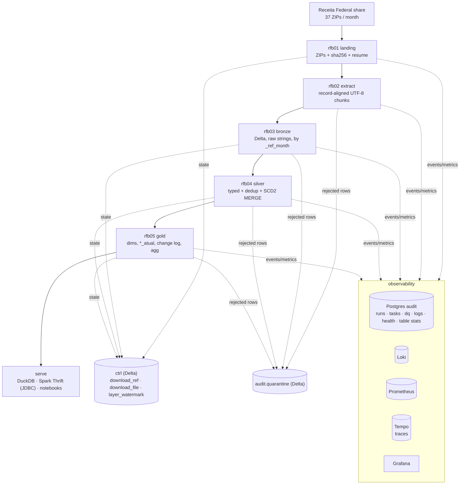
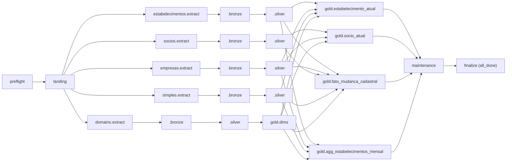
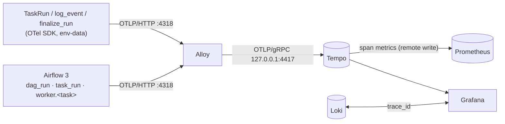

# lambda4 — RFB lakehouse architecture

Reference document for the RFB (Receita Federal, CNPJ open data) pipeline: what runs, where data lives, which script
writes which table, and how every step is observed. Study material in Portuguese: `docs/learning/`.
The ANP pipeline (Postgres bronze, Polars) has its own reference: `docs/architecture-anp.md`.

## 1. End-to-end flow

| Layer | Storage | Format | Retention |
|---|---|---|---|
| landing | `/mnt/hdd1tb/lambda-dump/landing/rfb/ref=YYYYMM/` (HDD 1 TB) | ZIP as published | forever (cold) |
| extract | `/srv/scratch/rfb-extract/ref=YYYYMM/<entity>/` (SSD) | UTF-8 CSV chunks + `_manifest.json` | deleted after bronze |
| bronze | `s3a://bronze/rfb/<entity>` (SeaweedFS on the USB HDD) | Delta, zstd, partition `_ref_month` | 3 months (never before silver applied them) |
| silver | `s3a://silver/rfb/<table>` | Delta, SCD2 history, CDF on | full history |
| gold | `s3a://gold/rfb/<table>` | Delta | rebuilt / per month |
| ctrl | `s3a://ctrl/<table>` | Delta (CDF, append-only) | forever |
| audit | Postgres `lambda.audit` + Delta `s3a://audit/quarantine` | tables / Delta | logs 90 days, rest forever |

## 2. The DAG `rfb_pipeline`

* Manual trigger with `ref_month` (YYYY-MM); `max_active_runs=1` (SCD2 needs months in order).
* Pools: `rfb_spark` = 1 slot (one Spark application at a time, it takes the 6 worker cores); `rfb_extract` = 1.
* `priority_weight=10` on the `estabelecimentos` lane (critical path).
* Exit code 99 → task **skipped** (e.g. month not published). `finalize` runs `all_done` and fails when the run failed.
* Failure/retry callbacks close the audit row when Airflow kills a task (timeout/OOM).

## 3. Lineage — which script reads and writes what

| Airflow task | Script | Reads | Writes (data) | Writes (control / audit) |
|---|---|---|---|---|
| `preflight` | `pipelines/rfb/rfb00_preflight.py` | S3, Spark master, metastore, disks, Loki, Pushgateway | — | `audit.health_check`, `audit.dq_event` |
| `landing` | `pipelines/rfb/rfb01_download.py` | Receita share (HTTPS) | landing ZIPs | `ctrl.download_ref`, `ctrl.download_file` |
| `<e>.extract` | `pipelines/rfb/rfb02_extract.py` | landing ZIPs | scratch chunks, `_manifest.json`, `_quarantine.jsonl` | `audit.*` |
| `<e>.bronze` | `pipelines/rfb/rfb03_bronze.py` | chunks + manifest, `ctrl.download_ref` | `rfb_bronze.<e>` | `ctrl.layer_watermark(bronze.<e>)`, `audit.quarantine`, `audit.quarantine_summary` |
| `<e>.silver` | `pipelines/rfb/rfb04_silver.py` | `rfb_bronze.<e>` (month), watermarks | `rfb_silver.<e>_hist` / code lists | `ctrl.layer_watermark(silver.<e>)`, `audit.delta_table_stats`, quarantine (conflicts) |
| `gold.dims` | `pipelines/rfb/rfb05_gold.py --target dims` | silver code lists | `rfb_gold.dim_*`, `dim_codigo` | watermark `gold.dims`, table stats |
| `gold.estabelecimento_atual` | `rfb05_gold.py` | estabelecimento/empresa/simples hist (as of M), dims | `rfb_gold.estabelecimento_atual` (by `uf`) | watermark, stats, dq |
| `gold.socio_atual` | `rfb05_gold.py` | socio/empresa hist, dims | `rfb_gold.socio_atual` | watermark, stats, dq |
| `gold.fato_mudanca_cadastral` | `rfb05_gold.py` | all `*_hist` | `rfb_gold.fato_mudanca_cadastral` (by `ref_month`) | watermark, stats |
| `gold.agg_estabelecimentos_mensal` | `rfb05_gold.py` | estabelecimento/empresa/simples hist | `rfb_gold.agg_estabelecimentos_mensal` (by `_ref_month`) | watermark, stats, dq |
| `maintenance` | `pipelines/rfb/rfb06_maintenance.py` | every Delta table | OPTIMIZE (only tables with ≥ 8 files averaging < 64 MiB, ADR 0005) / VACUUM | `audit.delta_table_stats` |
| `finalize` | `pipelines/commons/finalize_run.py` | `audit.task_run` | — | `audit.pipeline_run`, run metrics |

Every row of every audit table carries `run_id` (= Airflow `run_id`), every Delta write carries `_run_id`, and
`audit.delta_table_stats` maps (run, task) → (table, Delta version). That is the execution lineage.

## 4. Data model

### Silver (`rfb_silver`)
| Table | Natural key | Tracked (new version) | Type 1 (in place) |
|---|---|---|---|
| `estabelecimento_hist` | `cnpj` (14, alphanumeric-safe) | registration, status, activity, address | phones, e-mail, `cnpj_dv_valido` |
| `empresa_hist` | `cnpj_basico` | name, legal nature, qualification, capital, size, federative entity | — |
| `simples_hist` | `cnpj_basico` | Simples/MEI options and dates | — |
| `socio_hist` | `cnpj_basico + identificador_socio + cnpj_cpf_socio + nome_socio` | qualification, entry date, country, representative, age band | — |
| `cnae`, `motivo_situacao`, `municipio`, `natureza_juridica`, `pais`, `qualificacao_socio` | `codigo` | — (SCD1 snapshot) | — |

SCD2 columns: `_key, row_hash (xxhash64), t1_hash, valid_from, valid_to (YYYYMM, NULL = open), is_current,
change_type (NEW|CHANGED), closed_reason (CHANGED|ABSENT), _run_id, _updated_at`; table property
`lambda.scd2.last_month`. Engine: `pipelines/commons/scd2.py` (one MERGE per month).
Dedup (`silver_model.dedup`): one window per natural key ordered by `dedup_order` then every other column; a row
equal to the previous one is an exact duplicate, the first row wins, other distinct rows are conflicts (quarantine).

File sizing (ADR 0005): silver and gold write with Delta optimized writes (`DELTA_OPTIMIZED_WRITES`, ~256 MiB files,
`DELTA_TARGET_FILE_MB` in `pipelines/commons/spark.py`); bronze keeps one ~100 MB file per CSV split. Maintenance only
compacts tables with many small files, into files of up to the same target.

### Gold (`rfb_gold`) — Kimball
* Dimensions: `dim_cnae`, `dim_municipio`, `dim_natureza_juridica`, `dim_qualificacao_socio`, `dim_pais`,
  `dim_motivo_situacao`, `dim_codigo` (fixed layout codes).
* `estabelecimento_atual` (wide, one row per CNPJ, as of the latest month, partitioned by `uf`, no contact PII).
* `socio_atual`.
* `fato_mudanca_cadastral` (event fact: INCLUSAO / ALTERACAO per attribute / EXCLUSAO, partitioned by `ref_month`).
* `agg_estabelecimentos_mensal` (periodic snapshot aggregate, partitioned by `_ref_month`).

## 5. Observability map

| Signal | Produced by | Transport | Store | Seen in |
|---|---|---|---|---|
| Pipeline events (JSON) | `pipelines/commons/logger.py` | file → Alloy | Loki (`job=lambda-pipelines`) + `audit.log_event` | Grafana *Logs*, DBeaver |
| Airflow task logs (raw) | Airflow task runner | file → Alloy | Loki (`job=airflow-tasks`) | Grafana *Logs*, Airflow UI |
| Task/run audit | `TaskRun`, `finalize_run` | SQL | `audit.pipeline_run`, `audit.task_run` | Grafana *Pipeline health* |
| Data quality | `TaskRun.check` (registry `commons/dq.py`) | SQL | `audit.dq_event` | *Pipeline health*, alerts |
| Infra health | `rfb00_preflight` | SQL | `audit.health_check` | *Pipeline health* |
| Delta table state | `commons/delta_stats.py` | SQL | `audit.delta_table_stats` | *Pipeline health* (volume, files) |
| Rejected rows | bronze / silver | Delta + SQL | `audit.quarantine` + `audit.quarantine_summary` | *Pipeline health*, notebooks |
| Batch metrics | `commons/metrics.py`, `finalize_run` | Pushgateway | Prometheus (`job=lambda_pipeline`) | dashboards, alert rules |
| Airflow metrics | Airflow (OpenTelemetry, `OTEL_EXPORTER_OTLP_METRICS_*` env) | OTLP/HTTP → Alloy → remote write | Prometheus (`airflow_*`, `job="airflow"`) | *Airflow* dashboard, alerts |
| Run trace (OTel) | `commons/tracing.py` via `TaskRun`, `log_event`, `finalize_run` | OTLP/HTTP → Alloy :4318 → OTLP/gRPC :4417 | Tempo (`/var/lib/tempo`, 14 d) | *Pipeline health* → Trace (Tempo), Explore |
| Airflow trace | Airflow 3 (`AIRFLOW__TRACES__OTEL_ON`) | OTLP/HTTP → Alloy → Tempo | Tempo (service `airflow`) | Explore; linked from our task spans |
| Span metrics (RED) | Tempo metrics-generator | remote write | Prometheus (`traces_spanmetrics_*`, `traces_service_graph_*`) | Explore, Tempo → metrics links |
| Run trace (SQL fallback) | audit tables | view `audit.v_trace_spans` | Postgres | *Pipeline health* → Traces panel (audit SQL) |
| Spark execution | Spark UI / event log | — | `/mnt/datalake/spark-events` | Spark UI :4040, History :18080 |

Dashboards are code: `infra/grafana/build_dashboards.py` → `infra/grafana/install.sh`; every query is checked by
`infra/grafana/validate_dashboards.py`. Alert rules: `infra/prometheus/rules/lambda_pipeline.yml`.

### Traces (ADR 0004, phase 2)

* **One trace per run.** `trace_id = md5(run_id)`, root span id `md5(run_id/root)[:16]`, task span id
  `md5(run_id/task_id/attempt)[:16]` - the same ids `audit.v_trace_spans` computes in SQL. Every task process derives
  them on its own, so all tasks (and retries) of a DAG run land in one trace with no context passing.
* **Span tree.** `rfb.run` (written by `finalize_run`, or by the task itself for a standalone manual run) →
  `<task_id>[<entity>]` (one per attempt; attributes `pipeline, task_id, layer, entity, ref_month, run_id, attempt,
  airflow_task_id`, counters and status at the end; `dq_check` span events; exceptions recorded) → timed steps (every
  `log_event` with `seconds` or `latency_ms`, named `<event>[:<component|target|table|entity>]`).
* **Airflow's spans** live in their own trace (random id per DAG run). `TracedBashOperator` passes the current
  `worker.<task>` span as `TRACEPARENT`; our task span (and the root span) carries a *span link* to it, so Tempo
  jumps from "what our code did" to "what the scheduler/worker did" for the same task.
* **Logs ↔ traces.** Every JSON log line carries `trace_id`/`span_id` (Alloy also stores them as Loki structured
  metadata). Grafana: a Loki line → "Trace in Tempo"; a span → "Logs for this span" (`{job="lambda-pipelines"} |
  trace_id="…"` in the span's time window).
* **Never blocks a run.** `LAMBDA_OTEL_ENABLED=0`, a missing SDK or no collector on :4318 at start-up → tracing is a
  no-op (one warning line); Tempo down → Alloy retries from a bounded queue, then drops.

## 6. Runbook

* **Run a month:** start the on-demand services (`sudo systemctl start seaweedfs spark-master spark-worker
  spark-history loki alloy tempo`), then in Airflow unpause `rfb_pipeline` and *Trigger DAG w/ config*
  `{"ref_month": "2026-09"}`.
* **See a trace:** *Pipeline health* → "Trace of the run (Tempo)" for the selected run, or Explore → Tempo →
  TraceQL `{resource.service.name="lambda-rfb"}`; the trace id of any run is `md5(run_id)` (`SELECT md5(run_id)`).
* **Several manual scripts as one run:** `export LAMBDA_RUN_ID=manual__$(date -u +%Y%m%dT%H%M%SZ)`, run the scripts,
  then `python -m pipelines.commons.finalize_run --pipeline rfb` (closes the audit run and writes the root span).
* **Watch:** Airflow Grid (task logs live) · Spark UI `localhost:4040` · Grafana *RFB · Pipeline health & tracing*
  (select the run) · *Logs* dashboard.
* **Re-run a month:** trigger again with the same `ref_month`: bronze replaces its partition, silver rolls the month
  back and re-applies it (only the LAST applied month), gold rebuilds.
* **Next month:** trigger with the next `ref_month`. A gap is refused (BLOCK `silver.month_order`).
* **Backfill older history:** silver only accepts months in order from its first month. To start from an older
  month, drop `rfb_silver.*_hist` and the `silver.*` watermarks and load months oldest → newest.
* **Query:** `notebooks/` (DuckDB / Spark), DBeaver on Postgres `audit` (role `dbeaver_ro`), DBeaver on Delta via
  `sudo systemctl start spark-thrift` → `jdbc:hive2://localhost:10000`.
